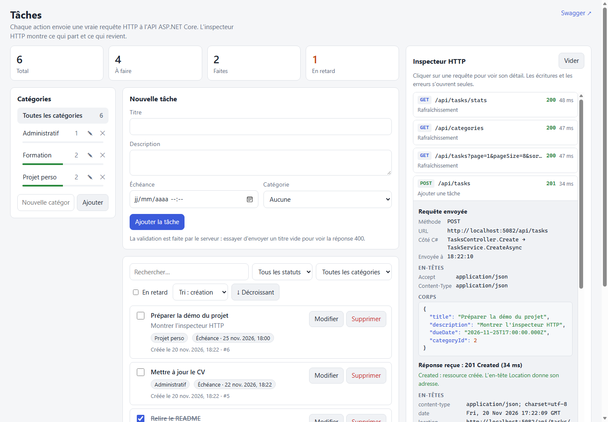

# Tasks API


**Tasks API** est une API REST de gestion de tâches écrite en C# avec ASP.NET Core 10 et Entity Framework Core. Elle permet de créer, modifier, cocher et supprimer des tâches, de les ranger par catégories, de les rechercher, filtrer, trier et paginer, et d'obtenir des statistiques d'avancement (tâches faites, à faire, en retard). Le projet montre une architecture back-end .NET volontairement simple et entièrement testée : contrôleurs, services injectés, DTOs validés, erreurs normalisées au format ProblemDetails et tests d'intégration. Pour s'en servir, il suffit de lancer `dotnet run` : l'API sert elle-même une interface web sur `http://localhost:5082`, où chaque action affiche dans un **inspecteur HTTP** la requête envoyée et la réponse reçue, et la documentation interactive Swagger est disponible sur `/swagger`.



## Sommaire

- [Fonctionnalités](#fonctionnalités)
- [Stack technique](#stack-technique)
- [Démarrage rapide](#démarrage-rapide)
- [Interface web](#interface-web)
- [Référence de l'API](#référence-de-lapi)
- [Exemples commentés](#exemples-commentés)
- [Choix techniques](#choix-techniques)
- [Tests](#tests)
- [Structure du projet](#structure-du-projet)
- [Limites connues](#limites-connues)
- [Équivalences NestJS ↔ ASP.NET Core](#équivalences-nestjs--aspnet-core)

## Fonctionnalités

- **CRUD complet** sur les tâches (titre, description, échéance, statut, catégorie) et sur les catégories.
- **Recherche plein texte** dans le titre et la description.
- **Filtres** par statut, par catégorie et sur les tâches en retard.
- **Tri** par date de création, échéance ou titre, dans les deux sens.
- **Pagination** avec métadonnées (`totalCount`, `totalPages`).
- **Statistiques** globales et par catégorie.
- **Validation** des entrées et **erreurs normalisées** (RFC 9457).
- **Interface web** avec inspecteur HTTP, en thème clair et sombre, utilisable sur mobile.
- **Documentation OpenAPI** et Swagger UI en développement.

## Stack technique

| Domaine | Choix |
| --- | --- |
| Langage, runtime | C# 14, .NET 10 (LTS) |
| Framework web | ASP.NET Core Web API, avec contrôleurs |
| Accès aux données | Entity Framework Core 10, migrations code first |
| Base de données | SQLite (fichier local, aucun serveur à installer) |
| Documentation | OpenAPI (`Microsoft.AspNetCore.OpenApi`) + Swagger UI |
| Tests | xUnit, `WebApplicationFactory`, SQLite en mémoire |
| Interface | HTML, CSS et JavaScript natifs (modules ES), sans étape de build |

## Démarrage rapide

**Prérequis** : le [SDK .NET 10](https://dotnet.microsoft.com/download/dotnet/10.0).

```bash
git clone https://github.com/Saldyr/task-api-C-.git
cd task-api-C-
dotnet run --project src/TasksApi
```

Au premier lancement, les migrations créent la base `src/TasksApi/tasks.db`. Ensuite :

| Adresse | Contenu |
| --- | --- |
| <http://localhost:5082> | Interface web |
| <http://localhost:5082/swagger> | Documentation interactive Swagger |
| <http://localhost:5082/openapi/v1.json> | Document OpenAPI brut |

En développement, le terminal affiche chaque requête SQL générée par EF Core : c'est le moyen le plus direct de voir ce que produit une requête LINQ.

Pour lancer les tests :

```bash
dotnet test
```

## Interface web

L'interface est un client de l'API comme un autre : elle ne fait qu'envoyer des requêtes HTTP. Son intérêt est l'**inspecteur HTTP**, qui détaille chaque échange :

- l'action de l'utilisateur à l'origine de la requête (« Ajouter une tâche », « Cocher une tâche »…) ;
- la méthode, l'URL complète et ses paramètres de query string ;
- les en-têtes et le corps JSON envoyés ;
- le code de réponse, accompagné d'une explication en français ;
- les en-têtes et le corps JSON reçus, avec coloration syntaxique ;
- la durée de l'échange ;
- la méthode C# qui l'a traitée, par exemple `TasksController.Create → TaskService.CreateAsync` ;
- la commande `curl` équivalente, copiable en un clic.

La validation n'est faite **que côté serveur** : envoyer un titre vide affiche la vraie réponse 400 de l'API, avec le message placé sous le champ concerné.

## Référence de l'API

### Tâches

| Méthode | Route | Description | Succès | Erreurs |
| --- | --- | --- | --- | --- |
| `GET` | `/api/tasks` | Liste paginée, filtrable et triable | 200 | 400 |
| `GET` | `/api/tasks/stats` | Statistiques globales et par catégorie | 200 | — |
| `GET` | `/api/tasks/{id}` | Détail d'une tâche | 200 | 404 |
| `POST` | `/api/tasks` | Création | 201 + `Location` | 400 |
| `PUT` | `/api/tasks/{id}` | Remplacement complet | 204 | 400, 404 |
| `PATCH` | `/api/tasks/{id}/status` | Changement du statut seul | 200 | 400, 404 |
| `DELETE` | `/api/tasks/{id}` | Suppression | 204 | 404 |

### Catégories

| Méthode | Route | Description | Succès | Erreurs |
| --- | --- | --- | --- | --- |
| `GET` | `/api/categories` | Liste, avec le nombre de tâches | 200 | — |
| `GET` | `/api/categories/{id}` | Détail | 200 | 404 |
| `POST` | `/api/categories` | Création | 201 + `Location` | 400, 409 |
| `PUT` | `/api/categories/{id}` | Renommage | 204 | 400, 404, 409 |
| `DELETE` | `/api/categories/{id}` | Suppression (les tâches sont conservées, sans catégorie) | 204 | 404 |

### Paramètres de `GET /api/tasks`

Tous les paramètres sont optionnels et se combinent.

| Paramètre | Valeurs | Défaut | Effet |
| --- | --- | --- | --- |
| `search` | texte (100 caractères max.) | — | Cherche dans le titre et la description |
| `isDone` | `true`, `false` | toutes | Filtre sur le statut |
| `categoryId` | entier | toutes | Filtre sur une catégorie |
| `overdue` | `true`, `false` | `false` | Tâches non faites dont l'échéance est passée |
| `sortBy` | `CreatedAt`, `DueDate`, `Title` | `CreatedAt` | Critère de tri |
| `sortDir` | `Asc`, `Desc` | `Desc` | Sens du tri |
| `page` | 1 à 10 000 | 1 | Numéro de page |
| `pageSize` | 1 à 100 | 10 | Taille de page |

### Modèles

```jsonc
// Tâche (réponse)
{
  "id": 3,
  "title": "Lire la doc EF Core",
  "description": "Chapitre sur les relations",
  "isDone": false,
  "createdAt": "2026-11-20T16:54:09.0617999Z",  // toujours en UTC
  "dueDate": "2026-12-01T09:00:00Z",            // optionnelle
  "categoryId": 1,                               // optionnelle
  "categoryName": "Formation"                    // renseignée si categoryId l'est
}
```

### Format des erreurs

Toutes les erreurs suivent le format **ProblemDetails** ([RFC 9457](https://www.rfc-editor.org/rfc/rfc9457)), avec le type de contenu `application/problem+json`. Les erreurs de validation ajoutent un objet `errors`, qui donne les messages champ par champ.

## Exemples commentés

**Créer une tâche.** L'API répond `201 Created` et indique l'adresse de la nouvelle ressource dans l'en-tête `Location`. Une échéance envoyée avec un décalage horaire est convertie en UTC.

```bash
curl -i -X POST http://localhost:5082/api/tasks \
  -H "Content-Type: application/json" \
  -d '{"title":"Préparer la démo","dueDate":"2026-12-01T10:00:00+02:00"}'
```

```http
HTTP/1.1 201 Created
Location: http://localhost:5082/api/tasks/1

{"id":1,"title":"Préparer la démo","description":null,"isDone":false,
 "createdAt":"2026-11-20T16:19:42.29Z","dueDate":"2026-12-01T08:00:00Z",
 "categoryId":null,"categoryName":null}
```

**Envoyer une donnée invalide.** Un titre vide est refusé avant même d'atteindre le contrôleur. La réponse indique quel champ pose problème.

```bash
curl -i -X POST http://localhost:5082/api/tasks \
  -H "Content-Type: application/json" -d '{"title":""}'
```

```json
{
  "type": "https://tools.ietf.org/html/rfc9110#section-15.5.1",
  "title": "One or more validation errors occurred.",
  "status": 400,
  "errors": { "Title": ["The Title field is required."] }
}
```

**Classer une tâche dans une catégorie.** On crée d'abord la catégorie, puis on y rattache la tâche par son identifiant. Une catégorie inconnue donne `400`, et un nom de catégorie déjà pris donne `409 Conflict`.

```bash
curl -X POST http://localhost:5082/api/categories \
  -H "Content-Type: application/json" -d '{"name":"Formation"}'

curl -X POST http://localhost:5082/api/tasks \
  -H "Content-Type: application/json" -d '{"title":"Lire la doc EF Core","categoryId":1}'
```

**Cocher une tâche.** `PATCH` ne modifie que le statut, sans renvoyer toute la tâche. La réponse contient la tâche à jour.

```bash
curl -X PATCH http://localhost:5082/api/tasks/1/status \
  -H "Content-Type: application/json" -d '{"isDone":true}'
```

**Combiner recherche, filtre, tri et pagination.** Cette requête donne les tâches en retard qui contiennent « doc », de l'échéance la plus ancienne à la plus récente, 5 par page.

```bash
curl "http://localhost:5082/api/tasks?search=doc&overdue=true&sortBy=DueDate&sortDir=Asc&page=1&pageSize=5"
```

```json
{ "items": [ ... ], "page": 1, "pageSize": 5, "totalCount": 7, "totalPages": 2 }
```

**Obtenir des statistiques.** Tous les compteurs sont calculés par la base (`COUNT` SQL), sans charger les tâches en mémoire.

```bash
curl http://localhost:5082/api/tasks/stats
```

```json
{
  "total": 12, "done": 5, "pending": 7, "overdue": 2, "uncategorized": 3,
  "byCategory": [ { "categoryId": 1, "categoryName": "Formation", "total": 4, "done": 1 } ]
}
```

## Choix techniques

**Contrôleurs plutôt que Minimal API.** Les contrôleurs regroupent les routes d'une ressource dans une classe, et les attributs (`[HttpGet]`, `[ApiController]`) décrivent le contrat au même endroit que le code. Pour une API de plusieurs ressources, cette structure reste plus lisible et plus proche des conventions des équipes .NET.

**Contrôleur → service → DbContext, sans couche repository.** Le `DbContext` d'EF Core joue déjà les rôles de repository et d'unité de travail. Ajouter une couche par-dessus ne ferait que déplacer les appels, sans rien apporter à cette taille de projet. Les services sont injectés via une interface (`ITaskService`) : le contrôleur ne dépend que d'un contrat, et l'implémentation se choisit à un seul endroit, dans `Program.cs`.

**DTOs séparés de l'entité.** Les entrées (`CreateTaskDto`, `UpdateTaskDto`…) n'exposent que les champs modifiables, ce qui empêche un client d'imposer un `id` ou une date de création (*overposting*). Les sorties (`TaskDto`) découplent le contrat public du schéma de la base, qui peut évoluer sans casser les clients.

**Validation déclarative.** Les règles sont écrites sous forme d'attributs (`[Required]`, `[MaxLength]`, `[Range]`) sur les DTOs. `[ApiController]` les vérifie avant d'exécuter l'action et renvoie automatiquement un 400 détaillé. Le contrôleur ne contient donc aucun code de validation. Un détail : le statut du `PATCH` est déclaré en `bool?`, car un `bool` vaut `false` quand le champ est absent, ce qui empêcherait `[Required]` d'échouer.

**Erreurs centralisées.** Les services lèvent une `ApiException` porteuse d'un code HTTP (400, 409). Un unique `IExceptionHandler` la convertit en ProblemDetails, et toute autre exception devient un 500 au même format. Les clients reçoivent ainsi une seule forme d'erreur, quelle que soit son origine.

**`PATCH` dédié au statut.** Cocher une tâche est l'action la plus fréquente. `PUT /api/tasks/{id}` remplace la ressource entière, alors que `PATCH /api/tasks/{id}/status` ne modifie qu'un champ : la requête est plus légère, et elle ne risque pas d'écraser une modification faite en parallèle sur un autre champ.

**Requêtes composées et pagination stable.** Les filtres s'ajoutent à un `IQueryable` qui n'est exécuté qu'une fois, en une seule requête SQL. Le tri finit toujours par l'identifiant (`ThenBy(t => t.Id)`) : sans ordre total, deux tâches de même date pourraient changer de page d'une requête à l'autre. Pour le tri par échéance, les tâches sans échéance passent toujours en dernier.

**Dates toujours en UTC.** SQLite stocke les dates en texte, sans fuseau horaire : relues telles quelles, elles perdent leur marqueur UTC (`Z`). Le service convertit donc toute date entrante en UTC, et un convertisseur EF Core marque toute date lue comme UTC. Ce défaut a été trouvé en testant l'API réelle ; un test le couvre maintenant.

**SQLite et migrations au démarrage.** SQLite ne demande aucune installation, ce qui permet de lancer le projet avec une seule commande. Les migrations sont appliquées au démarrage par commodité. En production, on les appliquerait plutôt lors du déploiement, et on choisirait un serveur comme PostgreSQL ou SQL Server : seul le fournisseur EF Core changerait.

**Tests d'intégration plutôt que tests unitaires de services.** `WebApplicationFactory` démarre toute l'application en mémoire, et les tests passent par de vraies requêtes HTTP. Ils couvrent ainsi le routage, la validation, la sérialisation, le SQL et les codes de retour. La base est une vraie base SQLite en mémoire, et non le fournisseur *InMemory* d'EF Core, qui n'est pas relationnel et ignore les contraintes (clés étrangères, index uniques).

**Interface sans framework ni build.** Le sujet du projet est le back-end. L'interface tient en trois modules JavaScript natifs servis par l'API (`wwwroot`) : un seul processus à lancer, aucune configuration CORS, aucune dépendance npm. Toutes les données affichées passent par `textContent`, jamais par `innerHTML`, ce qui évite les injections de HTML.

**Versions épinglées.** Le projet cible .NET 10, version LTS supportée jusqu'en novembre 2028. Les paquets Microsoft sont fixés en 10.0.x : les paquets 11.0 publiés depuis ne sont pas compatibles avec `net10.0`. L'outil `dotnet-ef` est déclaré comme outil local (`dotnet-tools.json`), pour que chacun utilise la même version.

## Tests

```bash
dotnet test
```

Les 22 tests d'intégration couvrent :

| Domaine | Cas vérifiés |
| --- | --- |
| Création et lecture | 201 + `Location`, lecture par id, dates en UTC à l'aller comme au retour |
| Erreurs | 404 au format ProblemDetails, titre vide, blanc, absent ou trop long → 400, catégorie inconnue → 400 |
| Statut | `PATCH` → 200, corps sans `isDone` → 400 |
| Liste | recherche + pagination, tri alphabétique, filtre des retards, paramètres invalides → 400 |
| Statistiques | compteurs par catégorie, cohérence `done + pending = total` |
| Catégories | création, nom nettoyé des espaces, doublon (même en changeant la casse) → 409, renommage en conflit → 409, suppression qui conserve les tâches |

Chaque classe de tests démarre sa propre API sur sa propre base en mémoire. Chaque test isole ses données par un identifiant unique, ce qui rend les tests indépendants de leur ordre d'exécution.

## Structure du projet

```text
├── src/TasksApi/
│   ├── Program.cs             Enregistrement des services et pipeline HTTP
│   ├── Controllers/           Routes HTTP : TasksController, CategoriesController
│   ├── Services/              Logique métier (interface + implémentation)
│   ├── Data/AppDbContext.cs   Contexte EF Core et configuration du modèle
│   ├── Models/                Entités persistées : TaskItem, Category
│   ├── Dtos/                  Contrats d'entrée/sortie, paramètres de recherche
│   ├── Errors/                ApiException et son gestionnaire global
│   ├── Migrations/            Migrations EF Core (générées)
│   └── wwwroot/               Interface web (HTML, CSS, JS)
├── tests/TasksApi.Tests/      Tests d'intégration xUnit
├── docs/                      Capture d'écran du README
└── dotnet-tools.json          Outils .NET locaux (dotnet-ef)
```

Pour créer une nouvelle migration après une modification du modèle :

```bash
dotnet tool restore
dotnet tool run dotnet-ef migrations add <NomDeLaMigration> --project src/TasksApi
```

## Limites connues

- **Pas d'authentification** : c'est un choix de périmètre. Toutes les routes sont publiques.
- **Insensibilité à la casse partielle** : la recherche et l'unicité des noms de catégorie ignorent la casse seulement pour les lettres sans accent (comportement de SQLite). « École » et « école » sont donc considérés comme différents.
- **Création concurrente de catégories** : si deux requêtes simultanées créent le même nom, l'index unique de la base refuse la seconde, qui reçoit alors un 500 au lieu d'un 409.
- **Migrations au démarrage** : c'est pratique en local, mais à déplacer dans le processus de déploiement pour un usage en production.

## Équivalences NestJS ↔ ASP.NET Core

Ce projet a été écrit en venant de l'écosystème TypeScript / NestJS / Prisma. Les commentaires du code font le lien avec ces concepts, et le tableau ci-dessous les résume.

| Concept | NestJS / Prisma | ASP.NET Core / EF Core |
| --- | --- | --- |
| Point d'entrée | `main.ts` + `AppModule` | `Program.cs` |
| Contrôleur | `@Controller('tasks')` | `[ApiController]` + `[Route("api/tasks")]` |
| Paramètres | `@Param()`, `@Query()`, `@Body()` | liaison automatique, `[FromQuery]` |
| Service et injection | `@Injectable()`, `providers` | `builder.Services.AddScoped<ITaskService, TaskService>()` |
| Portée des services | singleton par défaut | `AddSingleton` / `AddScoped` (par requête) / `AddTransient` |
| Validation | `class-validator` + `ValidationPipe` | Data Annotations + `[ApiController]` |
| Erreur HTTP | `HttpException` | `ApiException` (classe du projet) |
| Filtre d'exceptions global | `ExceptionFilter` | `IExceptionHandler` + `UseExceptionHandler()` |
| Asynchrone | `Promise<T>` | `Task<T>` |
| Client ORM | `PrismaClient` | `DbContext` |
| Schéma | `schema.prisma` | classes C# + `OnModelCreating` |
| Relation | `@relation(..., onDelete: SetNull)` | `HasOne().WithMany().OnDelete(DeleteBehavior.SetNull)` |
| Requête | `findMany({ where, include, skip, take })` | LINQ : `Where`, `Include`, `Skip`, `Take` |
| Mise à jour | `prisma.task.update()` | modification de l'objet suivi + `SaveChangesAsync()` |
| Migrations | `prisma migrate dev` / `deploy` | `dotnet ef migrations add` / `database update` |
| Fichiers statiques | `ServeStaticModule` | `UseDefaultFiles()` + `UseStaticFiles()` |
| Tests e2e | `Test.createTestingModule` + supertest | `WebApplicationFactory<Program>` + `HttpClient` |
